### `~/about`

I'm an IT support technician in Southern California working my way into cybersecurity. I fix computers for a living, study Cybersecurity at WGU, and spend my free time running a fictional company's IT department in my home lab, from the firewall to Active Directory.

---

### `~/experience`

**Geek Squad @ Best Buy** · *current*
- Diagnose and repair Windows and macOS devices from intake to pickup
- OS recovery, data backups and service tickets

**IT Support Intern @ LOG(N) Pacific** · *6 months, remote*
- Tier 1 support through a ticketing system
- Active Directory and Microsoft 365 user administration
- Azure virtual machine troubleshooting

---

### `~/featured-project`

<table>
<tr>
<td width="100%">

#### [🏦 Vellum Financial — Enterprise IT Homelab](https://github.com/diegomtzLAN/vellum-financial-homelab)

A fictional fintech company I run on two home servers, built and documented like a real IT department.

`Firewall + VLANs` `Active Directory` `Jump host` `Company wiki` `Wazuh SIEM (next)`

</td>
</tr>
</table>

---

### `~/tools`

  

---

### `~/currently`

- Studying for my B.S. in Cybersecurity & Information Assurance at WGU
- Adding a second server to my lab, then deploying Wazuh for security monitoring
- Open to **help desk**, **desktop support** and **junior SOC** roles

---

### `~/contact`

<!-- Add your LinkedIn badge here:

-->

